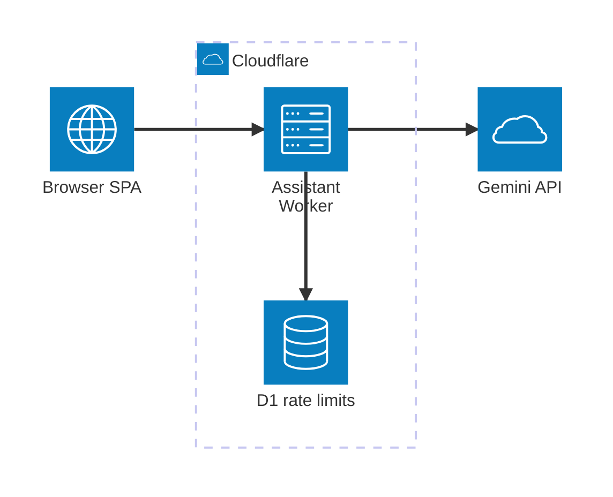
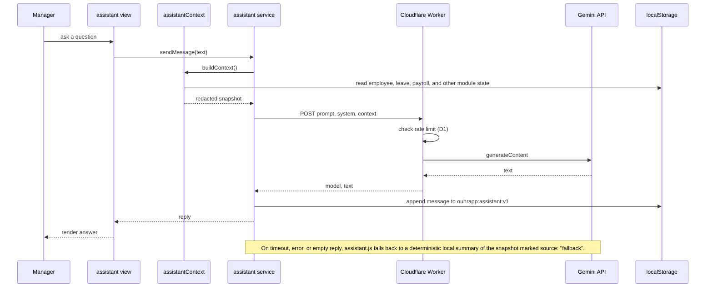

# Architecture

This document describes how ouhrapp is put together: the runtime pieces, how they connect, and where data lives. It complements `DFD.md` (data movement) and `ERD.md` (data model). The production target follows the stack and phasing in `MIGRATION.md`.

The diagrams use Mermaid's `architecture-beta` syntax, which needs Mermaid 11.1.0 or newer. Icons mark each node type: `internet` for clients, `server` for compute, `database` for relational stores, `disk` for object storage, and `cloud` for managed services.

## Current prototype

The prototype runs mostly in the browser. A static single-page app holds all state in `localStorage`, and one Cloudflare Worker brokers assistant calls to the Gemini API with a per-IP rate limit backed by D1.

The browser app is layered: `main.js` boots auth, the shell, and the router; views compose shared components and read and write through the store, which persists to `localStorage`; services isolate the redacted assistant context and the network call. `MIGRATION.md` maps this store, service, and view layering onto API, service, and UI layering in production.

## Production target

The full build moves rendering, data, and storage server side. A Next.js app on Vercel serves the UI and hosts route handlers and server actions on the Node runtime. Drizzle talks to PostgreSQL with row-level security per tenant. Background jobs handle schedules, reminders, and exports. Cloudflare holds object storage, cache, and the assistant Worker; the Gemini key stays server side.

## Stack

Drawn from the recommended stack in `MIGRATION.md`.

| Layer | Choice |
| --- | --- |
| App | Next.js (App Router), React, TypeScript |
| Styling | Tailwind CSS using the prototype tokens as the theme |
| Data grids and charts | TanStack Table, Recharts |
| Forms and validation | React Hook Form with Zod, schemas shared between client and server |
| ORM and database | Drizzle ORM over PostgreSQL (Neon or Supabase) with row-level security |
| Auth and access | Auth.js (NextAuth) with roles, 2FA, and session rotation |
| Object storage | Cloudflare R2, signed URLs and virus scanning |
| Email and notifications | Resend or Cloudflare Email, plus in-app notifications |
| Background jobs | Inngest or pg-boss, with Cloudflare Cron for schedules |
| Cache and rate limiting | Upstash Redis or Cloudflare KV |
| Observability | Sentry with structured logs and uptime checks |
| Testing | Vitest for units, Playwright for end to end |
| Hosting and CI/CD | Vercel for the app, Cloudflare for storage, queues, cron, DNS, and WAF; GitHub Actions gates |

## Assistant request flow

The assistant builds a redacted snapshot of all modules, sends it with the manager's question to the Worker, and renders the reply. Private data (individual salaries, contact details, government ids, confidential case narratives) is stripped before the request leaves the browser. Production moves the context build and the call server side.

## Data stores

| Store | Stage | Location | Key | Contents |
| --- | --- | --- | --- | --- |
| Application state | Prototype | localStorage | `ouhrapp:data:v1` | All module records: employees, recruitment, onboarding, leave, attendance, payroll, performance, compensation, relations, workforce plans, audit log. |
| Session | Prototype | localStorage | `ouhrapp:session:v1` | Prototype auth session (single `admin` account). |
| Assistant history | Prototype | localStorage | `ouhrapp:assistant:v1` | Recent manager and assistant messages, capped for prompt context. |
| Rate limit | Prototype | Cloudflare D1 | Worker table | Per-IP request counters for the assistant endpoint. |
| Tenant data | Production | PostgreSQL | Per table, scoped by `tenant_id` | Every prototype collection plus `audit_log`, `notifications`, `attachments`, `sessions`, `invitations`, `feature_flags`, and assistant conversations. See `ERD.md`. |

## Design constraints

- No framework, no build step, no runtime dependencies in the client. The app runs from `file://` or any static host.
- The prototype auth gate is client side and gates the demo UI only. Production authenticates and authorizes server side, with row-level security enforced in the database.
- The assistant depends on an external endpoint and stays useful offline through the local fallback snapshot. It only advises; every decision goes through a permission-checked endpoint.
- Prototype storage is browser local. Nothing is sent to a server except the optional assistant request described above.
