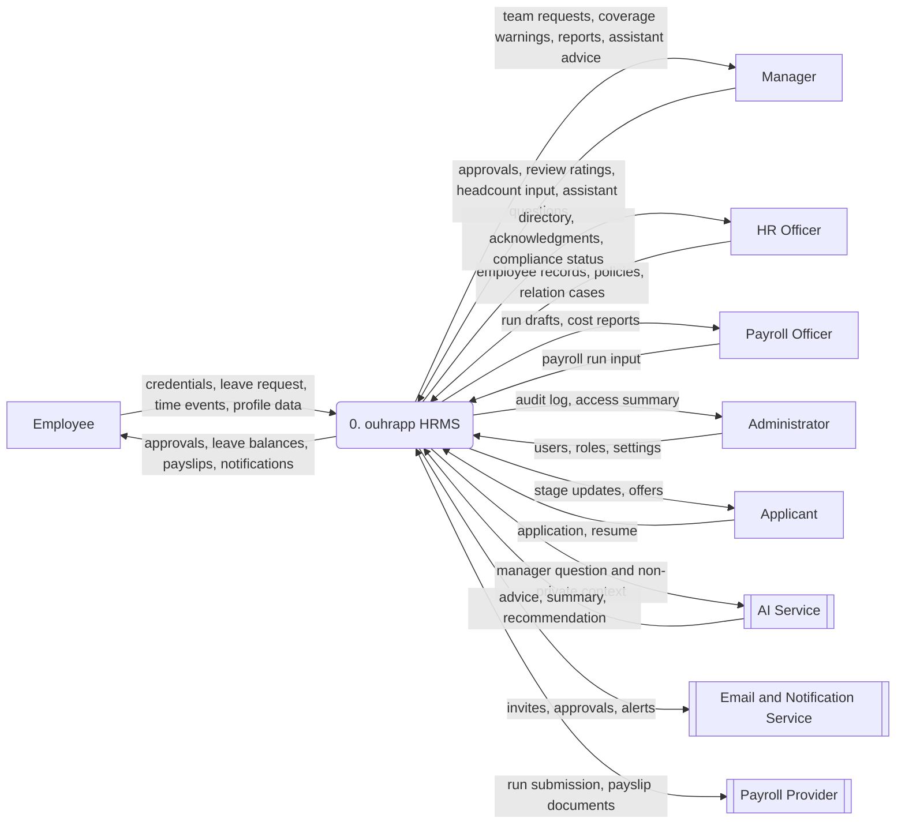
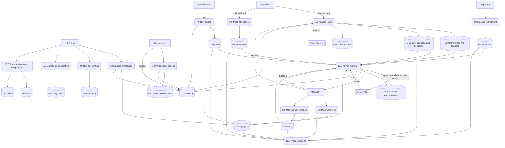

# DFD: Data Flow Diagram

This document models how data moves through ouhrapp. It uses a Gane and Sarson style notation, rendered with Mermaid, and covers the system at two levels: the context diagram (Level 0) and the top-level decomposition (Level 1).

## Notation

| Symbol | Meaning | Mermaid shape |
| --- | --- | --- |
| Rectangle | External entity, a source or sink of data outside the system | `[Entity]` |
| Rounded rectangle | Process that transforms data | `("n.0 Process")` |
| Open-ended rectangle | Data store | `[("Dn store")]` |
| Arrow | Data flow, labelled with the data carried | `-->|label|` |

## Level 0: Context diagram

The system is a single process. External entities exchange data with it.

## Level 1: Top-level decomposition

The system decomposes into thirteen processes and a set of data stores. External entities shown are the primary ones.

## Process descriptions

| Process | Name | Input | Output | Stores |
| --- | --- | --- | --- | --- |
| 1.0 | Manage employees | Employee records from HR, edits | Directory entries, change history | D1, D13 |
| 2.0 | Plan workforce | Headcount targets from Manager | Plan vs actual, gap | D1, D11 |
| 3.0 | Manage recruitment | Applications, stage moves | Candidate pipeline, stage events | D2 |
| 4.0 | Run onboarding | New hire, template | Task checklist, progress | D3 |
| 5.0 | Manage leave | Leave request, balances, blackout windows, manager decision | Approved or rejected request, updated balance | D10, D11, D14, D13 |
| 6.0 | Track attendance | Clock events, manual entries | Hours, approval state | D4 |
| 7.0 | Run payroll | Salaries, pay period | Run draft, payslips | D5, D1, D13 |
| 8.0 | Manage performance | Cycle, ratings | Review records | D6 |
| 9.0 | Manage compensation | Bands, adjustments | Salary band set, history | D7 |
| 10.0 | Track relations and compliance | Cases, policy events | Case log, acknowledgments | D8, D9 |
| 11.0 | Produce reports | Aggregated data | Dashboards, exports | reads D1, D2, D4, D5, D6, D11 |
| 12.0 | Administer access | Users, roles, invites | Memberships, sessions | D12, D13 |
| 13.0 | Advise manager | Manager question, non-private snapshot | Advice, summary, recommendation | D15, D13; reads D1, D2, D4, D5, D6, D10, D11 |

## Data stores

| Store | Holds | Written by | Read by |
| --- | --- | --- | --- |
| D1 employees | Employee records and departments | 1.0, 4.0, 7.0 | 1.0, 2.0, 5.0, 7.0, 11.0, 13.0 |
| D2 candidates | Candidates and stage events | 3.0 | 3.0, 11.0, 13.0 |
| D3 onboarding | Onboarding flows and tasks | 4.0 | 4.0, 11.0 |
| D4 time entries | Time and attendance rows | 6.0 | 6.0, 7.0, 11.0, 13.0 |
| D5 payroll | Payroll runs and payslips | 7.0 | 7.0, 11.0, 13.0 |
| D6 reviews | Review cycles and reviews | 8.0 | 8.0, 11.0, 13.0 |
| D7 salary bands | Salary bands and adjustments | 9.0 | 9.0, 7.0 |
| D8 cases | Relation cases and events | 10.0 | 10.0 |
| D9 policies | Policies and acknowledgments | 10.0 | 10.0, 11.0 |
| D10 leave types and balances | Leave policy and balances | 5.0 | 5.0, 13.0 |
| D11 leave requests and decisions | Leave requests and their final decisions | 5.0 | 2.0, 5.0, 11.0, 13.0 |
| D12 users and sessions | Users, memberships, sessions, invites | 12.0 | all processes |
| D13 audit log | One row per mutation | 1.0, 5.0, 7.0, 12.0, 13.0 | 11.0, 12.0 |
| D14 blackout dates | Company and department blackout windows | 5.0 | 5.0 |
| D15 assistant conversations | Chat turns per manager | 13.0 | 13.0 |

## Key data flows

| Flow | From | To | Data |
| --- | --- | --- | --- |
| Leave request | Employee | 5.0 Manage leave | Type, dates, days, reason |
| Leave decision | Manager | 5.0 Manage leave | Approve or reject |
| Decision record | 5.0 Manage leave | D11 | Final status, deciding actor, timestamp |
| Assistant question | Manager | 13.0 Advise manager | Natural language question |
| Assistant context | 13.0 Advise manager | AI Service | Question, recent turns, non-private snapshot of the stores |
| Assistant advice | AI Service | 13.0 Advise manager | Answer, summary, recommendation |
| Conversation | 13.0 Advise manager | D15 | Turns with role, source, and model |
| Attendance | Employee | 6.0 Track attendance | Clock in and out, manual entries |
| Payroll run | Payroll Officer | 7.0 Run payroll | Pay period, inclusion set |
| Report query | Reports consumer | 11.0 Produce reports | Filter and scope |
| Audit entry | Mutating processes | D13 | Actor, entity, action, before, after |

## Notes on the runtime call

The AI Service is a secondary actor, not a data store. In the prototype the browser calls the Gemini endpoint on a Cloudflare Worker directly, sending the manager question, the recent turns, and a non-private snapshot of the stores. In production the same flow is issued server side so the key never ships to the client, with per-tenant rate limiting and a short cache. On timeout or an empty reply the flow short-circuits to a local snapshot summary marked as a fallback, so the AI path is never on the critical path for correctness. The assistant only advises; the manager still makes and records every decision.
