# ERD: Entity Relationship Diagram

This document specifies the data model for ouhrapp. It is derived from three sources, the prototype dataset in `../js/seed.js`, the target schema in `MIGRATION.md`, and the product spec in `../requirements.txt`.

Two views are given. The relational target is the normalized model the production build uses. The prototype view notes where the same data is embedded rather than normalized today.

## Conventions

- Every table carries `id` (uuid, primary key), `tenant_id` (foreign key to `tenants`), `created_at`, `updated_at`, and `created_by` unless noted otherwise below. These common columns are omitted from the entity dictionary for brevity.
- The application is multi-tenant. Row-level security isolates every table by `tenant_id`.
- Money is stored as integer minor units. Dates are stored as `date` or `timestamptz`.
- PII fields, specifically salary and government IDs, are encrypted at the field level.

## Diagram

```mermaid
erDiagram
  TENANTS ||--o{ MEMBERSHIPS : has
  USERS ||--o{ MEMBERSHIPS : joins
  TENANTS ||--o{ EMPLOYEES : employs
  DEPARTMENTS ||--o{ EMPLOYEES : groups
  EMPLOYEES ||--o{ EMPLOYEES : manages
  DEPARTMENTS ||--o{ HEADCOUNT_PLANS : plans
  TENANTS ||--o{ CANDIDATES : receives
  CANDIDATES ||--o{ CANDIDATE_STAGE_EVENTS : logs
  CANDIDATES ||--o| EMPLOYEES : converts_to
  EMPLOYEES ||--o{ ONBOARDING_FLOWS : onboards
  ONBOARDING_FLOWS ||--o{ ONBOARDING_TASKS : contains
  EMPLOYEES ||--o{ TIME_ENTRIES : logs
  TENANTS ||--o{ PAYROLL_RUNS : runs
  PAYROLL_RUNS ||--o{ PAYSLIPS : produces
  EMPLOYEES ||--o{ PAYSLIPS : receives
  TENANTS ||--o{ REVIEW_CYCLES : schedules
  REVIEW_CYCLES ||--o{ REVIEWS : contains
  EMPLOYEES ||--o{ REVIEWS : receives
  EMPLOYEES ||--o{ GOALS : owns
  DEPARTMENTS ||--o{ SALARY_BANDS : defines
  EMPLOYEES ||--o{ COMPENSATION_ADJUSTMENTS : gets
  EMPLOYEES ||--o{ EMPLOYEE_RELATIONS_CASES : subjects
  EMPLOYEE_RELATIONS_CASES ||--o{ CASE_EVENTS : logs
  TENANTS ||--o{ POLICIES : publishes
  POLICIES ||--o{ POLICY_ACKNOWLEDGMENTS : tracks
  EMPLOYEES ||--o{ POLICY_ACKNOWLEDGMENTS : acknowledges
  TENANTS ||--o{ LEAVE_TYPES : defines
  TENANTS ||--o{ BLACKOUT_DATES : sets
  EMPLOYEES ||--o{ LEAVE_BALANCES : holds
  LEAVE_TYPES ||--o{ LEAVE_BALANCES : typed_by
  EMPLOYEES ||--o{ LEAVE_REQUESTS : files
  LEAVE_TYPES ||--o{ LEAVE_REQUESTS : typed_by
  LEAVE_REQUESTS ||--|| LEAVE_DECISIONS : decided_by
  TENANTS ||--o{ AUDIT_LOG : records
  USERS ||--o{ AUDIT_LOG : acts
  USERS ||--o{ NOTIFICATIONS : receives
  USERS ||--o{ SESSIONS : opens
  TENANTS ||--o{ INVITATIONS : issues
  USERS ||--o{ ASSISTANT_CONVERSATIONS : opens
  ASSISTANT_CONVERSATIONS ||--o{ ASSISTANT_MESSAGES : contains

  TENANTS {
    uuid id PK
    string name
    string slug
  }
  USERS {
    uuid id PK
    string email
    string name
    string password_hash
    boolean two_factor_enabled
  }
  MEMBERSHIPS {
    uuid id PK
    uuid user_id FK
    uuid tenant_id FK
    string role
  }
  EMPLOYEES {
    uuid id PK
    uuid tenant_id FK
    uuid department_id FK
    uuid manager_id FK
    string first_name
    string last_name
    string email
    string title
    string status
    date start_date
    int salary
    string employment_type
  }
  DEPARTMENTS {
    uuid id PK
    uuid tenant_id FK
    string name
  }
  HEADCOUNT_PLANS {
    uuid id PK
    uuid department_id FK
    string period
    int planned
  }
  CANDIDATES {
    uuid id PK
    uuid tenant_id FK
    string name
    string role
    string stage
  }
  CANDIDATE_STAGE_EVENTS {
    uuid id PK
    uuid candidate_id FK
    string from_stage
    string to_stage
    timestamptz occurred_at
  }
  ONBOARDING_FLOWS {
    uuid id PK
    uuid employee_id FK
    date start_date
    string status
  }
  ONBOARDING_TASKS {
    uuid id PK
    uuid flow_id FK
    string label
    boolean done
    int position
  }
  TIME_ENTRIES {
    uuid id PK
    uuid employee_id FK
    date work_date
    numeric hours
    string note
    string source
    string approval_state
  }
  PAYROLL_RUNS {
    uuid id PK
    string period
    int headcount
    int gross
    int net
    string status
  }
  PAYSLIPS {
    uuid id PK
    uuid run_id FK
    uuid employee_id FK
    int gross
    int net
    uuid attachment_id FK
  }
  REVIEW_CYCLES {
    uuid id PK
    string name
    string period
  }
  REVIEWS {
    uuid id PK
    uuid cycle_id FK
    uuid employee_id FK
    uuid reviewer_id FK
    int rating
    string status
  }
  GOALS {
    uuid id PK
    uuid employee_id FK
    string title
    int progress
  }
  SALARY_BANDS {
    uuid id PK
    uuid department_id FK
    string level
    int min_amount
    int max_amount
  }
  COMPENSATION_ADJUSTMENTS {
    uuid id PK
    uuid employee_id FK
    int amount
    date effective_date
  }
  EMPLOYEE_RELATIONS_CASES {
    uuid id PK
    uuid employee_id FK
    string subject
    string type
    string status
    date opened_on
  }
  CASE_EVENTS {
    uuid id PK
    uuid case_id FK
    string note
    timestamptz occurred_at
  }
  POLICIES {
    uuid id PK
    string name
    text body
  }
  POLICY_ACKNOWLEDGMENTS {
    uuid id PK
    uuid policy_id FK
    uuid employee_id FK
    timestamptz acknowledged_at
  }
  LEAVE_TYPES {
    uuid id PK
    string name
    boolean paid
    int notice_days
    boolean requires_doc
    int max_concurrent
  }
  BLACKOUT_DATES {
    uuid id PK
    string label
    date from_date
    date to_date
  }
  LEAVE_BALANCES {
    uuid id PK
    uuid employee_id FK
    uuid leave_type_id FK
    string period
    int accrued
    int used
  }
  LEAVE_REQUESTS {
    uuid id PK
    uuid employee_id FK
    uuid leave_type_id FK
    date start_date
    date end_date
    int days
    string reason
    string status
    timestamptz submitted_at
  }
  LEAVE_DECISIONS {
    uuid id PK
    uuid leave_request_id FK
    string final_status
    string decided_by
    timestamptz decided_at
    string source
  }
  ASSISTANT_CONVERSATIONS {
    uuid id PK
    uuid tenant_id FK
    uuid user_id FK
    string title
    timestamptz last_activity_at
  }
  ASSISTANT_MESSAGES {
    uuid id PK
    uuid conversation_id FK
    string role
    text content
    string source
    string model
    timestamptz created_at
  }
  AUDIT_LOG {
    uuid id PK
    uuid actor_id FK
    string entity
    uuid entity_id
    string action
    json before
    json after
  }
  NOTIFICATIONS {
    uuid id PK
    uuid user_id FK
    string type
    json payload
    timestamptz read_at
  }
  SESSIONS {
    uuid id PK
    uuid user_id FK
    string token
    timestamptz expires_at
  }
  INVITATIONS {
    uuid id PK
    string email
    string role
    string token
    timestamptz expires_at
  }
```

## Entity dictionary

### Tenancy and access

| Entity | Key fields | Notes |
| --- | --- | --- |
| tenants | id, name, slug | The organization. Root of tenant isolation. |
| users | id, email, name, password_hash, two_factor_enabled | Auth.js user. A person who can sign in. |
| memberships | id, user_id, tenant_id, role | Joins a user to a tenant with a role. Roles are admin, HR, manager, employee, payroll officer. |
| sessions | id, user_id, token, expires_at | Server-side session, supports rotation. |
| invitations | id, email, role, token, expires_at | Admin-issued invite for a new user to join the tenant. |

### Employees

| Entity | Key fields | Notes |
| --- | --- | --- |
| employees | id, department_id, manager_id, first_name, last_name, email, title, status, start_date, salary, employment_type | The core record. `manager_id` is a self reference. `salary` is field-encrypted. |
| departments | id, name | Replaces the prototype `DEPARTMENTS` constant. |

### Workforce planning

| Entity | Key fields | Notes |
| --- | --- | --- |
| headcount_plans | id, department_id, period, planned | Unique on (tenant, department, period). |

### Recruitment

| Entity | Key fields | Notes |
| --- | --- | --- |
| candidates | id, name, role, stage | Stage is one of Applied, Screening, Interview, Offer, Hired. |
| candidate_stage_events | id, candidate_id, from_stage, to_stage, occurred_at | Event log of stage transitions, for funnel metrics. |

### Onboarding and offboarding

| Entity | Key fields | Notes |
| --- | --- | --- |
| onboarding_flows | id, employee_id, start_date, status | One per new hire. Templates live in `onboarding_templates`. |
| onboarding_tasks | id, flow_id, label, done, position | Checklist items inside a flow. |

### Time and attendance

| Entity | Key fields | Notes |
| --- | --- | --- |
| time_entries | id, employee_id, work_date, hours, note, source, approval_state | `source` is manual or clock; `approval_state` supports approvals. |

### Payroll

| Entity | Key fields | Notes |
| --- | --- | --- |
| payroll_runs | id, period, headcount, gross, net, status | One row per pay period. Tax and disbursement come from the provider. |
| payslips | id, run_id, employee_id, gross, net, attachment_id | Per-employee payslip, document stored via `attachments`. |

### Performance

| Entity | Key fields | Notes |
| --- | --- | --- |
| review_cycles | id, name, period | A cycle such as 2026 H1. |
| reviews | id, cycle_id, employee_id, reviewer_id, rating, status | One review per employee per cycle. |
| goals | id, employee_id, title, progress | Optional goal tracking. 360 feedback tables are added here in production. |

### Compensation

| Entity | Key fields | Notes |
| --- | --- | --- |
| salary_bands | id, department_id, level, min_amount, max_amount | Per department and level. |
| compensation_adjustments | id, employee_id, amount, effective_date | History of pay changes. |

### Relations and compliance

| Entity | Key fields | Notes |
| --- | --- | --- |
| employee_relations_cases | id, employee_id, subject, type, status, opened_on | Case log. `type` is Mediation, Disciplinary, or Grievance. |
| case_events | id, case_id, note, occurred_at | Notes appended to a case. |
| policies | id, name, body | Company policy documents. |
| policy_acknowledgments | id, policy_id, employee_id, acknowledged_at | Per-employee acknowledgment. Replaces the prototype counter. |

### Leave

| Entity | Key fields | Notes |
| --- | --- | --- |
| leave_types | id, name, paid, notice_days, requires_doc, max_concurrent | Encodes policy. Matches the prototype fields exactly. |
| blackout_dates | id, label, from_date, to_date | Optionally per department. |
| leave_balances | id, employee_id, leave_type_id, period, accrued, used | Remaining is computed as accrued minus used. |
| leave_requests | id, employee_id, leave_type_id, start_date, end_date, days, reason, status, submitted_at | A filed request. |
| leave_decisions | id, leave_request_id, final_status, decided_by, decided_at, source | Immutable record of the outcome. `source` is human (a manager decided) or system (a manager-approved batch action). |

### Manager assistant

| Entity | Key fields | Notes |
| --- | --- | --- |
| assistant_conversations | id, tenant_id, user_id, title, last_activity_at | One thread per manager. Scoped to the tenant. |
| assistant_messages | id, conversation_id, role, content, source, model, created_at | Turn history. `role` is user or assistant; `source` is ai or fallback; `model` records the model that answered. |

The assistant holds no separate business data: its context is derived on demand from the other tables. Only the conversation history is persisted.

### Cross-cutting

| Entity | Key fields | Notes |
| --- | --- | --- |
| audit_log | id, actor_id, entity, entity_id, action, before, after | One row per mutation. |
| notifications | id, user_id, type, payload, read_at | In-app notifications, delivered over SSE or WebSocket. |
| attachments | id, entity, entity_id, storage_key, filename, content_type, uploaded_by | Object storage metadata for R2 or Supabase Storage. |
| feature_flags | id, tenant_id, key, enabled | Gate each module so it ships and rolls back independently. |

## Relationship summary

| Relationship | Cardinality | Meaning |
| --- | --- | --- |
| tenants to memberships | 1 to many | A tenant has many memberships. |
| users to memberships | 1 to many | A user can belong to one or more tenants. |
| tenants to employees | 1 to many | A tenant employs many employees. |
| departments to employees | 1 to many | A department groups many employees. |
| employees to employees | 1 to many | A manager manages many employees (self reference). |
| employees to leave_requests | 1 to many | An employee files many leave requests. |
| leave_requests to leave_decisions | 1 to 1 | Each request has exactly one decision record. |
| employees to leave_balances | 1 to many | An employee holds one balance per leave type. |
| leave_types to leave_balances | 1 to many | A leave type applies to many balances. |
| users to assistant_conversations | 1 to many | A manager opens many assistant threads. |
| assistant_conversations to assistant_messages | 1 to many | A conversation contains many turns. |
| candidates to employees | 1 to 0 or 1 | A hired candidate becomes one employee. |
| payroll_runs to payslips | 1 to many | A run produces one payslip per employee. |
| policies to policy_acknowledgments | 1 to many | A policy is tracked per employee. |
| tenants to audit_log | 1 to many | Every mutation is recorded. |

## Prototype mapping

The prototype holds whole collections in `localStorage` as plain arrays. Most map one to one to a target table. The differences are worth noting:

- `onboardings` embed their `tasks` array. In the target, `onboarding_tasks` is a separate table.
- `leaveRequests` embed a single `decision` object holding the final status and who decided it. In the target this becomes the `leave_decisions` row; the AI feature no longer runs, so there are no rule-result or AI-assessment rows.
- `assistant` history is not in the seed. The prototype keeps chat turns in `localStorage` under `ouhrapp:assistant:v1`. In the target they become `assistant_conversations` and `assistant_messages`, scoped by tenant and user.
- `policies` store an `acknowledged` counter. In the target this becomes `policy_acknowledgments`, one row per employee.
- `candidates` store only the current stage. In the target, `candidate_stage_events` records each transition.
- `users` and `employees` are separate and are not linked in the prototype. In the target, `employees` links to a `users` row through `memberships`.
- `DEPARTMENTS` and `STAGES` are constants in the prototype. In the target, departments become a table and stages become an enumerated column plus the event log.
