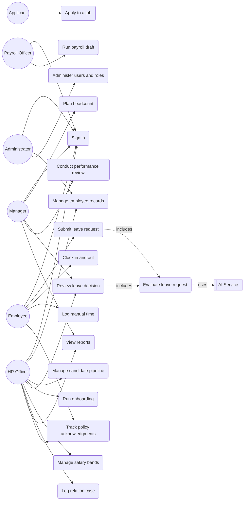

# Use Case

This document describes what each actor does in ouhrapp. It covers the actors, a use case diagram, a summary of every use case, and full descriptions for the key ones, with emphasis on the leave automation flow.

## Actors

| Actor | Type | Description |
| --- | --- | --- |
| Employee | Primary | Staff member. Submits leave, clocks time, acknowledges policy, views own data. |
| Manager | Primary | Approves leave and time, plans headcount, runs reviews for the team. |
| HR Officer | Primary | Manages employee records, onboarding, compensation, relations, recruitment. |
| Payroll Officer | Primary | Prepares payroll runs and payslips. |
| Administrator | Primary | Manages users, roles, tenant settings, and reviews the audit log. |
| Applicant | Primary | External candidate who applies and moves through the pipeline. |
| AI Service | Secondary | Evaluates a leave request and returns a structured assessment. |
| Email and Notification Service | Secondary | Delivers invites, approvals, and alerts. |
| Payroll Provider | Secondary | Owns tax, deductions, payslip generation, and disbursement. |

A user can hold more than one role. Roles are enforced server side on every read and write.

## Use case diagram

## Summary

| ID | Use case | Primary actor | Module |
| --- | --- | --- | --- |
| UC-01 | Sign in | All users | Administration |
| UC-02 | Manage employee records | HR Officer, Administrator | Employee data |
| UC-03 | Plan headcount | Manager | Workforce planning |
| UC-04 | Manage candidate pipeline | HR Officer | Recruitment |
| UC-05 | Apply to a job | Applicant | Recruitment |
| UC-06 | Run onboarding checklist | HR Officer | Onboarding |
| UC-07 | Submit leave request | Employee | Leave automation |
| UC-08 | Evaluate leave request | System (rules and AI) | Leave automation |
| UC-09 | Review and override leave decision | Manager, HR Officer | Leave automation |
| UC-10 | Clock in and out | Employee | Time and attendance |
| UC-11 | Log manual time entry | Employee, Manager | Time and attendance |
| UC-12 | Run payroll draft | Payroll Officer | Payroll |
| UC-13 | Conduct performance review | Manager | Performance |
| UC-14 | Manage salary bands | HR Officer | Compensation |
| UC-15 | Log relation case | HR Officer | Relations and compliance |
| UC-16 | Track policy acknowledgments | HR Officer, Employee | Relations and compliance |
| UC-17 | View reports | Manager, HR Officer | Reporting |
| UC-18 | Administer users and roles | Administrator | Administration |

## Detailed use cases

### UC-01 Sign in

- Actor: any user.
- Goal: obtain an authenticated session.
- Preconditions: the user has an account or a pending invite.
- Trigger: the user opens the app without a session.
- Main flow:
  1. The system shows the sign-in form.
  2. The user enters email and password.
  3. The system verifies the password against the stored hash.
  4. The system creates a session and loads the shell and navigation.
- Alternate flows:
  - 3a. Credentials are wrong. The system shows an error and clears the password field.
  - 3b. The account is an unaccepted invite. The system routes the user to set a password.
- Postconditions: a valid session exists; access is scoped by role.

In the prototype this is a client-side gate with the account `admin` and password `admin123`. In production it is Auth.js with credentials plus Google and Microsoft SSO and 2FA.

### UC-04 Manage candidate pipeline

- Actor: HR Officer, Recruiter.
- Goal: move candidates through the hiring stages.
- Preconditions: the user is signed in as HR.
- Trigger: a candidate is added or advanced.
- Main flow:
  1. The system shows the pipeline as a kanban with the stages Applied, Screening, Interview, Offer, and Hired.
  2. The user adds a candidate or advances an existing one.
  3. The system records the stage change as an event.
  4. On reaching Hired, the system offers to start onboarding.
- Alternate flows:
  - 2a. The user moves a candidate backward. The system records the reverse event.
- Postconditions: the candidate stage is updated and an event is logged.

### UC-07 Submit leave request

- Actor: Employee.
- Goal: file a leave request.
- Preconditions: the user is signed in and has a leave balance.
- Trigger: the user submits the leave form.
- Main flow:
  1. The user picks a leave type, start date, end date, and reason.
  2. The system computes the number of days.
  3. The system runs UC-08 to evaluate the request.
  4. The system shows the outcome and stores the request with its decision.
- Alternate flows:
  - 2a. End date precedes start date. The system rejects the input.
  - 3a. A hard rule fails. The request is rejected and the reason is shown.
- Postconditions: a leave request and its decision exist, and the employee is notified.

### UC-08 Evaluate leave request

- Actor: System, using the AI Service as a secondary actor.
- Goal: produce a decision for a request.
- Preconditions: a request exists with its employee, type, and dates.
- Trigger: included by UC-07 and UC-09.
- Main flow:
  1. The system runs the deterministic checks: balance, notice period, supporting document, blackout window, and team coverage. Each returns pass, flag, or fail.
  2. If any check fails, the system rejects and stops.
  3. Otherwise the system builds a prompt with the request, policy, and coverage, and calls the AI Service.
  4. The AI Service returns a decision, confidence, rationale, and flags as strict JSON.
  5. The system blends the results and sets the final status: Approved, Rejected, or Needs review.
- Alternate flows:
  - 3a. A flag exists or confidence is below the bar. The system routes to Needs review.
  - 4a. The AI call times out or returns unparseable output. The system falls back to a rules-only decision marked `source: fallback`.
- Postconditions: an immutable decision record exists with rule results and, when used, the AI assessment. The AI never overrides a hard rule failure.

### UC-09 Review and override leave decision

- Actor: Manager, HR Officer.
- Goal: resolve a request flagged for human review, or override an automatic decision.
- Preconditions: a request is in Needs review, or a decision exists to be changed.
- Trigger: the reviewer opens the leave queue.
- Main flow:
  1. The reviewer opens a request and sees the rule results and the AI rationale.
  2. The reviewer approves or rejects.
  3. The system appends a human decision with the actor and timestamp and updates the request status.
  4. The employee is notified.
- Alternate flows:
  - 1a. The request is already resolved. The reviewer can still override, and the override is recorded as a new decision.
- Postconditions: the final status reflects the human decision, and the change is audited.

### UC-12 Run payroll draft

- Actor: Payroll Officer.
- Goal: produce a payroll run for a period.
- Preconditions: employees have active salaries and the period is open.
- Trigger: the officer starts a run.
- Main flow:
  1. The system gathers active employees and their salaries.
  2. The system sends the run to the Payroll Provider for tax and deductions.
  3. The provider returns gross, deductions, and net per employee.
  4. The system stores the run and payslips and marks the run as Draft.
  5. The officer reviews and submits for approval and disbursement.
- Alternate flows:
  - 2a. The provider is unavailable. The run stays in Draft and can be retried.
- Postconditions: a payroll run and payslips exist; no tax logic runs in this system.

## Relationships

- Include: UC-07 and UC-09 both include UC-08. Sign in (UC-01) is a precondition shared by all other use cases.
- Extend: UC-09 extends UC-08 when a human overrides an automatic outcome.
- Secondary actors: UC-08 uses the AI Service, UC-12 uses the Payroll Provider, and approval and invite flows use the Email and Notification Service.
