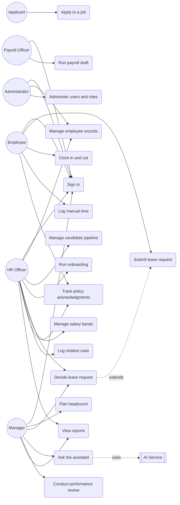

# Use Case

This document describes what each actor does in ouhrapp. It covers the actors, a use case diagram, a summary of every use case, and full descriptions for the key ones, with emphasis on the manager assistant flow.

## Actors

| Actor | Type | Description |
| --- | --- | --- |
| Employee | Primary | Staff member. Submits leave, clocks time, acknowledges policy, views own data. |
| Manager | Primary | Decides leave and time, plans headcount, runs reviews for the team, and asks the assistant for advice. |
| HR Officer | Primary | Manages employee records, onboarding, compensation, relations, recruitment. |
| Payroll Officer | Primary | Prepares payroll runs and payslips. |
| Administrator | Primary | Manages users, roles, tenant settings, and reviews the audit log. |
| Applicant | Primary | External candidate who applies and moves through the pipeline. |
| AI Service | Secondary | Answers a manager question using a non-private snapshot of the data. |
| Email and Notification Service | Secondary | Delivers invites, approvals, and alerts. |
| Payroll Provider | Secondary | Owns tax, deductions, payslip generation, and disbursement. |

A user can hold more than one role. Roles are enforced server side on every read and write.

## Use case diagram

## Summary

| ID | Use case | Primary actor | Module |
| --- | --- | --- | --- |
| UC-01 | Sign in | All users | Administration |
| UC-02 | Manage employee records | HR Officer, Administrator | Employee data |
| UC-03 | Plan headcount | Manager | Workforce planning |
| UC-04 | Manage candidate pipeline | HR Officer | Recruitment |
| UC-05 | Apply to a job | Applicant | Recruitment |
| UC-06 | Run onboarding checklist | HR Officer | Onboarding |
| UC-07 | Submit leave request | Employee | Leave |
| UC-08 | Decide leave request | Manager, HR Officer | Leave |
| UC-09 | Ask the assistant | Manager | Assistant |
| UC-10 | Clock in and out | Employee | Time and attendance |
| UC-11 | Log manual time entry | Employee, Manager | Time and attendance |
| UC-12 | Run payroll draft | Payroll Officer | Payroll |
| UC-13 | Conduct performance review | Manager | Performance |
| UC-14 | Manage salary bands | HR Officer | Compensation |
| UC-15 | Log relation case | HR Officer | Relations and compliance |
| UC-16 | Track policy acknowledgments | HR Officer, Employee | Relations and compliance |
| UC-17 | View reports | Manager, HR Officer | Reporting |
| UC-18 | Administer users and roles | Administrator | Administration |

## Detailed use cases

### UC-01 Sign in

- Actor: any user.
- Goal: obtain an authenticated session.
- Preconditions: the user has an account or a pending invite.
- Trigger: the user opens the app without a session.
- Main flow:
  1. The system shows the sign-in form.
  2. The user enters email and password.
  3. The system verifies the password against the stored hash.
  4. The system creates a session and loads the shell and navigation.
- Alternate flows:
  - 3a. Credentials are wrong. The system shows an error and clears the password field.
  - 3b. The account is an unaccepted invite. The system routes the user to set a password.
- Postconditions: a valid session exists; access is scoped by role.

In the prototype this is a client-side gate with the account `admin` and password `admin123`. In production it is Auth.js with credentials plus Google and Microsoft SSO and 2FA.

### UC-04 Manage candidate pipeline

- Actor: HR Officer, Recruiter.
- Goal: move candidates through the hiring stages.
- Preconditions: the user is signed in as HR.
- Trigger: a candidate is added or advanced.
- Main flow:
  1. The system shows the pipeline as a kanban with the stages Applied, Screening, Interview, Offer, and Hired.
  2. The user adds a candidate or advances an existing one.
  3. The system records the stage change as an event.
  4. On reaching Hired, the system offers to start onboarding.
- Alternate flows:
  - 2a. The user moves a candidate backward. The system records the reverse event.
- Postconditions: the candidate stage is updated and an event is logged.

### UC-07 Submit leave request

- Actor: Employee.
- Goal: file a leave request.
- Preconditions: the user is signed in and has a leave balance.
- Trigger: the user submits the leave form.
- Main flow:
  1. The user picks an employee, a leave type, start date, end date, and reason.
  2. The system computes the number of days from the inclusive date range.
  3. The system stores the request with status `Needs review` and no decision yet.
  4. The request appears in the leave queue for a manager to decide.
- Alternate flows:
  - 2a. End date precedes start date. The system rejects the input.
  - 2b. A date is missing. The system does not create the request.
- Postconditions: a leave request exists in `Needs review`. Nothing is decided automatically.

### UC-08 Decide leave request

- Actor: Manager, HR Officer.
- Goal: approve or reject a filed request.
- Preconditions: a request is in `Needs review`.
- Trigger: the reviewer opens the leave queue.
- Main flow:
  1. The reviewer opens the request and sees the type, dates, days, reason, and remaining balance.
  2. The reviewer approves or rejects.
  3. The system records the final status with the deciding actor and timestamp.
  4. On approval the system commits the days against the employee's leave balance.
  5. The change is written to the audit log.
- Alternate flows:
  - 1a. The reviewer is unsure. They can open the assistant (UC-09) for the policy and coverage picture first.
  - 4a. The remaining balance is short. The days are still committed, and the leave view shows the negative remaining balance.
- Postconditions: the request has a final status and an attributable decision record.

### UC-09 Ask the assistant

- Actor: Manager.
- Goal: get advice on a decision across any module.
- Preconditions: the user is signed in as a manager.
- Trigger: the user sends a message in the assistant view.
- Main flow:
  1. The user types a question or picks a suggested prompt.
  2. The system appends the question to the conversation history.
  3. The system builds a snapshot of non-private data across every module: headcount and gaps, recruitment stages, onboarding progress, attendance hours, payroll run summaries, performance ratings, salary bands, relations counts, compliance acknowledgments, and leave requests and balances.
  4. The system sends the snapshot, the recent turns, and the system prompt to the AI Service.
  5. The AI Service returns an answer with a recommendation and its reason.
  6. The system renders the answer and stores the turn.
- Alternate flows:
  - 3a. The question touches private data, for example an individual salary or a case narrative. The system refuses and offers an aggregate or non-private angle instead.
  - 4a. The AI Service times out, errors, or returns an empty reply. The system answers with a deterministic local summary of the same snapshot, marked as a fallback.
  - 4b. The question is about data not present in the snapshot. The system says it is not available rather than inventing it.
- Postconditions: the conversation history has one more turn. No business data is changed; the assistant only advises and the manager still decides in UC-08.

### UC-12 Run payroll draft

- Actor: Payroll Officer.
- Goal: produce a payroll run for a period.
- Preconditions: employees have active salaries and the period is open.
- Trigger: the officer starts a run.
- Main flow:
  1. The system gathers active employees and their salaries.
  2. The system sends the run to the Payroll Provider for tax and deductions.
  3. The provider returns gross, deductions, and net per employee.
  4. The system stores the run and payslips and marks the run as Draft.
  5. The officer reviews and submits for approval and disbursement.
- Alternate flows:
  - 2a. The provider is unavailable. The run stays in Draft and can be retried.
- Postconditions: a payroll run and payslips exist; no tax logic runs in this system.

## Relationships

- Precondition: sign in (UC-01) is required by every other use case.
- Extend: UC-08 extends UC-07 by applying the manager's decision to a submitted request.
- Secondary actors: UC-09 uses the AI Service, UC-12 uses the Payroll Provider, and approval and invite flows use the Email and Notification Service.

The assistant is the only place the AI Service appears. It advises on decisions; it never changes data, so every write still goes through its owning module.
